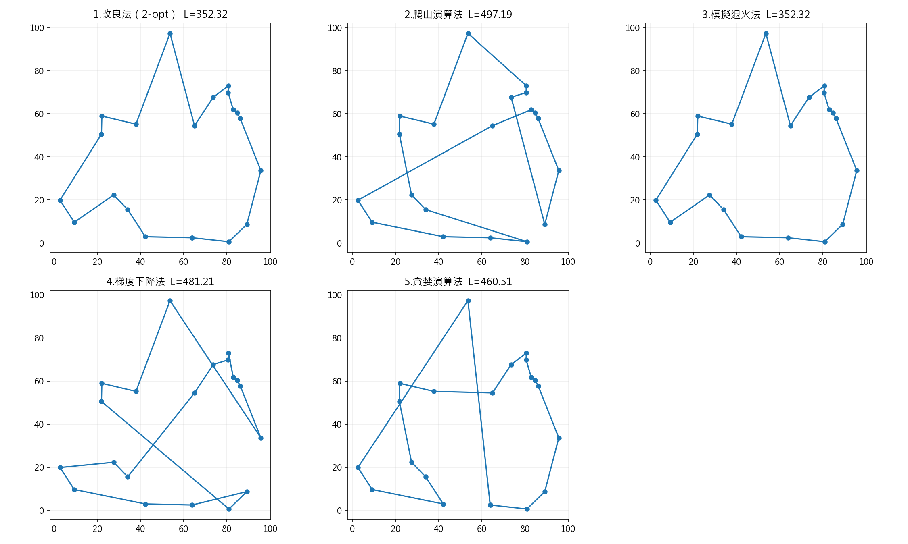

# 旅行推銷員問題（TSP）——五種方法比較

## 一、題目說明

分別使用以下五種方法求解旅行推銷員問題：

1. 改良法（2-opt）
2. 爬山演算法
3. 模擬退火法
4. 梯度下降法
5. 貪婪演算法

旅行推銷員需要拜訪每個城市恰好一次，最後返回起點，目標是讓整條路線的總距離盡可能短。本程式使用相同的 20 個城市比較五種方法，不保證找到全域最佳解。

## 二、執行環境與操作方式

需要 Python 3.8 以上版本，以及 NumPy。安裝 Matplotlib 後可以輸出比較圖。

### 安裝套件

```bash
python -m pip install numpy matplotlib
```

### 執行程式

將終端機切換至 `tsp.py` 所在的資料夾，執行：

```bash
python tsp.py
```

若只想儲存圖片而不開啟視窗：

```bash
python tsp.py --no-show
```

Windows 若使用 `py` 指令，可將上述指令中的 `python` 改為 `py`。

### 輸出內容

- 終端機：各方法的路線長度、執行時間與城市拜訪順序。
- 圖片：`tsp_results.png`，儲存於 `tsp.py` 所在資料夾。
- 城市編號為 `0` 至 `19`；輸出的路線會在最後重複起點，表示返回出發城市。
- 若未安裝 Matplotlib，程式仍會列出計算結果，但略過繪圖。
- 圖表會優先使用已安裝的中文字型；若找不到支援的中文字型，則改用英文標題。

## 三、測試資料與距離計算

使用 `random.Random(42)` 產生 20 個城市，每個城市的 X、Y 座標均介於 0 到 100。固定亂數種子，讓不同方法使用同一組資料。

城市之間使用歐氏距離：

```text
d(i, j) = sqrt((x_i - x_j)^2 + (y_i - y_j)^2)
```

距離矩陣具有對稱性，即 `d(i, j) = d(j, i)`。路線長度由相鄰城市的距離逐段累加，最後加上終點返回起點的距離。

程式會檢查每個結果是否包含所有城市且沒有重複，避免將非法路線納入比較。

## 四、五種方法的實作

### 1. 改良法（2-opt）

先以貪婪法建立初始路線，再檢查兩條不相鄰的邊是否能透過重新連接來縮短距離。重新連接時，反轉兩條邊之間的城市順序，維持完整巡迴路線。

每輪完整檢查 2-opt 鄰域，選擇距離減少最多的操作；當沒有超過容差的改善時停止。

- 主要函式：`improvement()`、`best_two_opt_move()`。
- 初始路線：從城市 0 出發的貪婪解。
- 特點：能有效改善繞遠與交叉路線。
- 限制：停止時僅表示無法再透過目前的 2-opt 操作改善，不代表全域最佳。

### 2. 爬山演算法

先隨機排列所有城市，再隨機選兩個位置交換。程式先複製出候選路線，只有候選路線更短時才取代目前路線，因此不需要在失敗時還原交換。

- 主要函式：`hill_climbing()`。
- 預設嘗試次數：20,000 次。
- 亂數種子：1。
- 特點：規則簡單，每次接受的變動都會縮短路線。
- 限制：不接受較差路線，容易受局部最佳影響；固定次數停止也不代表已完整驗證局部最佳。

### 3. 模擬退火法

從隨機路線開始，以反轉一段城市順序產生候選解。若候選解較短就接受；若沒有改善，則依照 `exp(-Δ / T)` 的機率接受，其中 `Δ` 是距離差值，`T` 是目前溫度。

溫度較高時較容易接受變差的路線，隨著降溫逐漸轉為保守搜尋。程式回傳整個過程中找到的最佳路線。

- 主要函式：`simulated_annealing()`。
- 初始溫度：100。
- 結束溫度：0.001。
- 每輪溫度乘上：0.995。
- 每個溫度嘗試次數：100 次。
- 亂數種子：1。
- 特點：有機會跳出局部最佳解。
- 限制：結果受到降溫速度與搜尋次數影響，並不保證全域最佳。

### 4. 梯度下降法

TSP 是離散排列問題，不能直接對城市編號做一般梯度下降。因此先將問題轉為連續權重矩陣，再解碼成城市排列。

`P[k, i]` 表示第 k 個位置分配給城市 i 的權重。程式對參數矩陣 `W` 使用逐列 softmax，讓每列權重總和等於 1。

優化目標包含：

1. 相鄰位置的加權距離，包含最後位置回到第一位置。
2. 懲罰項：鼓勵每個城市的總分配權重接近 1。

透過鏈式微分求出 `W` 的梯度，更新後再使用最大權重配對解碼。每次選定一個位置與城市後，排除該列與該欄，確保最終路線為合法排列。

- 主要函式：`gradient_descent()`、`row_softmax()`、`decode_assignment()`。
- 迭代次數：3,000 次。
- 基礎學習率：0.05，隨迭代逐步衰減；更新式另乘以 10，沿用課堂設定。
- 懲罰係數：30。
- 亂數種子：1，使用 NumPy 亂數產生器。
- 特點：示範以連續最佳化處理離散問題。
- 限制：懲罰項不是硬性限制，連續目標下降也不保證解碼後的路線更短；浮點運算差異可能影響結果。

### 5. 貪婪演算法

從城市 0 出發，使用迴圈找出最近的未訪問城市，持續選擇直到所有城市都已拜訪，最後回到起點。

- 主要函式：`greedy()`。
- 使用布林串列 `visited` 記錄城市是否已訪問。
- 特點：容易理解、計算快速，也能作為其他方法的初始解。
- 限制：只考慮當下最近的選擇，可能留下很長的最後一段路線。

## 五、程式結構與改寫方式

以課堂提供的五種方法為基礎，保留題目、測試資料及主要演算法設定，調整程式的組織與語法寫法。

| 項目 | 本程式的寫法 |
| --- | --- |
| 城市產生 | 用一般迴圈逐一加入座標 |
| 距離矩陣 | 計算上三角後填入對稱位置 |
| 資料傳遞 | 透過函式參數傳入距離矩陣，減少全域變數依賴 |
| 路線長度 | 逐段累加後，另外補上回程距離 |
| 貪婪選擇 | 用 `visited` 與迴圈尋找最近城市 |
| 爬山候選解 | 先複製路線，改善時才更新 |
| 區段反轉 | 抽成 `reverse_segment()` 共用函式 |
| 2-opt 搜尋 | 將尋找最佳改善獨立成函式 |
| 梯度下降 | 將 softmax 與排列解碼拆成獨立函式 |
| 執行入口 | 使用 `main()`，提供 `--no-show` 選項 |

語法與函式拆分的差異不代表使用新的演算法；本程式仍然實作題目指定的五種方法。

## 六、實測結果

以下為整理此程式時，在執行環境中實際執行 `python tsp.py --no-show` 所得到的一次結果。執行時間依硬體、套件與系統負載而異。

| 方法 | 路線長度 | 耗時（秒） | 本次排名 |
| --- | ---: | ---: | ---: |
| 改良法（2-opt） | 352.32 | 0.0004 | 並列 1 |
| 爬山演算法 | 497.19 | 0.0722 | 5 |
| 模擬退火法 | 352.32 | 0.9187 | 並列 1 |
| 梯度下降法 | 449.05 | 0.1117 | 3 |
| 貪婪演算法 | 460.51 | 0.0000 | 4 |

貪婪法顯示的 `0.0000` 秒是小數位數四捨五入的結果，不代表完全沒有運算時間。

老師提供的圖片中，梯度下降長度為 462.65；本次實測為 449.05。梯度下降搭配非凸目標及離散解碼，結果可能受到浮點運算順序與環境差異影響，報告應以實際執行輸出為準。此處未將老師的數值當作本程式的實測數值。

### 結果分析

1. 本次 2-opt 與模擬退火取得相同的最短顯示長度 352.32，但尚未證明是全域最佳解。
2. 2-opt 將貪婪解從 460.51 改善至 352.32，依顯示值計算約縮短 23.49%。
3. 爬山法只接受交換後的改善，可能卡在不易透過交換繼續改善的路線。
4. 模擬退火可接受較差解，但本設定約評估 230,000 條候選路線，搜尋預算比爬山法的 20,000 次更大。
5. 梯度下降先解連續模型，再解碼成排列，其目標值與實際路線長度不完全等同。
6. 貪婪法執行快速，但局部最近的選擇不一定形成整體最短路線。

各方法的初始路線、鄰域與搜尋預算並不完全一致。因此這份結果是目前設定下的比較，不能直接推論某方法在所有資料上都比較好。

## 七、結果圖片

執行程式後，會產生五種路線的比較圖。將本檔與圖片放在同一資料夾，即可使用下列相對路徑顯示圖片：



若尚未執行程式或沒有放入圖片，Markdown 預覽可能無法顯示上圖。

## 八、結論與參考

本作業以相同城市資料實作五種 TSP 求解方法，觀察搜尋策略如何影響路線品質與執行時間。本次 2-opt 與模擬退火找到較短路線，貪婪法適合快速產生初始解，爬山法呈現局部搜尋的限制，梯度下降則展示連續鬆弛的應用及解碼限制。

參考來源：老師提供的 TSP 五種解法 Python 範例與結果圖片。程式在此基礎上改寫函式結構與部分語法，並加入執行選項、路線驗證及字型處理。
